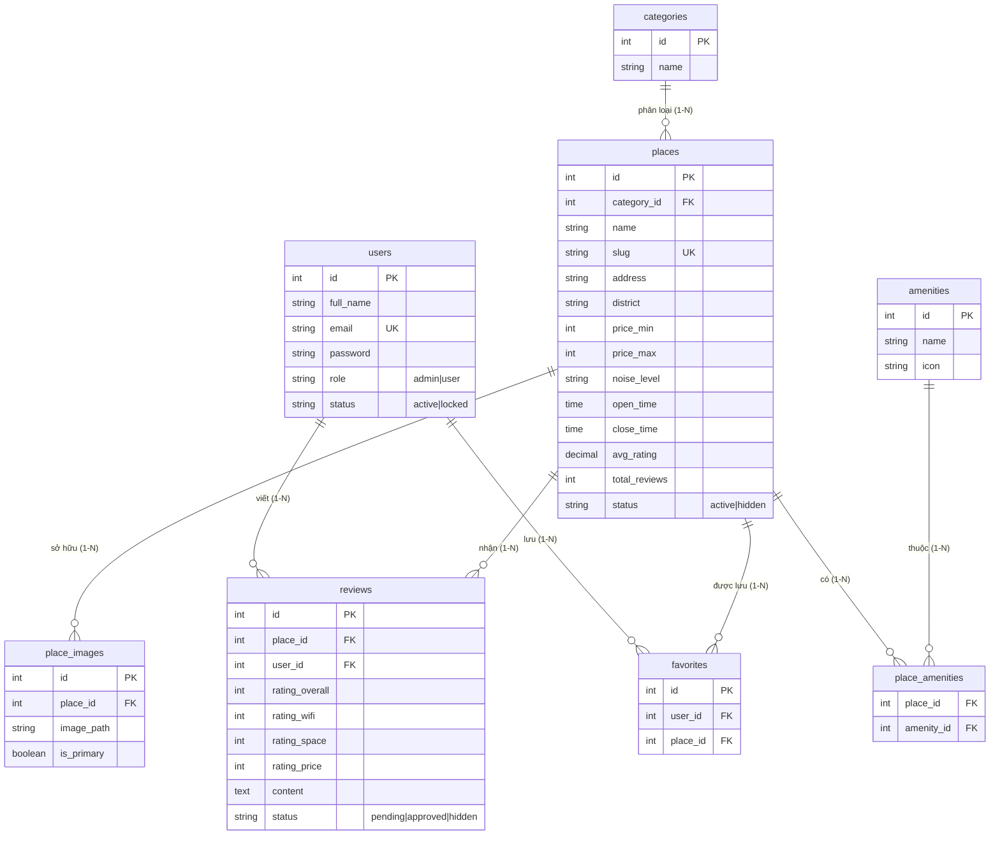

# StudySpot – Website Review Quán Nước & Cà Phê Học Bài Dành Cho Sinh Viên

<p align="center">
  
  
  
  
  
  
  
</p>

> **Nền tảng tra cứu, đánh giá quán cà phê và không gian học bài quanh Trường Đại học An Giang (AGU)**  
> *Đồ án môn học: Công nghệ Web – PHP (Mã học phần: SEE518)*

---

## 📌 Thông Tin Đồ Án & Sinh Viên Thực Hiện

* **Cơ sở đào tạo:** Trường Đại học An Giang (AGU) – Đại học Quốc gia TP. Hồ Chí Minh
* **Khoa:** Khoa Công nghệ Thông tin
* **Học phần:** Công nghệ Web – PHP (Mã học phần: **SEE518**)
* **Đề tài:** **StudySpot – Nền tảng Review Quán Nước & Cà Phê Học Bài Dành Cho Sinh Viên**
* **Sinh viên thực hiện:** Huỳnh Nguyễn Phương Đông
* **Mã số sinh viên (MSSV):** DTH235628
* **Lớp:** DH23TH (Ngành Tin học / Công nghệ Thông tin)
* **Email liên hệ:** phuongdong1741@gmail.com
* **Địa bàn khảo sát thực tế:** Thành phố Long Xuyên, Tỉnh An Giang (Tập trung khu vực quanh cơ sở chính Ung Văn Khiêm & cơ sở cũ Định Mỹ / Trần Hưng Đạo)
* **Thời gian hoàn thiện:** Tháng 11/2026

---

## 📑 Mục Lục

1. [Giới thiệu Dự án & Tính Cấp Thiết](#-1-giới-thiệu-dự-án--tính-cấp-thiết)
2. [Các Phân Hệ & Chức Năng Chính](#-2-các-phân-hệ--chức-năng-chính)
   - [2.1. Phân hệ Khách vãng lai (Guest)](#21-phân-hệ-khách-vãng-lai-guest)
   - [2.2. Phân hệ Thành viên Sinh viên (User)](#22-phân-hệ-thành-viên-sinh-viên-user)
   - [2.3. Đăng nhập Google SSO cho Sinh viên AGU](#23-đăng-nhập-google-sso-cho-sinh-viên-agu-agueduvn)
   - [2.4. Phân hệ Quản trị viên (Admin)](#24-phân-hệ-quản-trị-viên-admin)
3. [Kiến Trúc Kỹ Thuật & Luồng Xử Lý (Architecture)](#-3-kiến-trúc-kỹ-thuật--luồng-xử-lý-architecture)
   - [3.1. Luồng vòng đời Request MVC](#31-luồng-vòng-đời-request-mvc)
   - [3.2. Cấu trúc Cơ sở dữ liệu (8 Bảng 3NF)](#32-cấu-trúc-cơ-sở-dữ-liệu-8-bảng-chuẩn-hóa-3nf)
   - [3.3. Sơ đồ Quan hệ Thực thể (ERD)](#33-sơ-đồ-quan-hệ-thực-thể-erd)
4. [Bảng Định Tuyến Hệ Thống (Route Map)](#-4-bảng-định-tuyến-hệ-thống-route-map)
5. [Điểm Nhấn Kỹ Thuật & Bảo Mật Web (OWASP)](#-5-điểm-nhấn-kỹ-thuật--bảo-mật-web-owasp)
6. [Cấu Trúc Thư Mục Dự Án](#-6-cấu-trúc-thư-mục-dự-án)
7. [Hướng Dẫn Cài Đặt & Triển Khai (Setup Guide)](#-7-hướng-dẫn-cài-đặt--triển-khai-setup-guide)
   - [7.1. Yêu cầu môi trường](#71-yêu-cầu-môi-trường)
   - [7.2. Các bước cài đặt chi tiết trên XAMPP](#72-các-bước-cài-đặt-chi-tiết-trên-xampp)
   - [7.3. Cấu hình Google OAuth 2.0 (@agu.edu.vn)](#73-cấu-hình-google-oauth-20-tùy-chọn)
   - [7.4. Khởi chạy nhanh bằng PHP Built-in Server](#74-chạy-nhanh-bằng-php-built-in-server-tùy-chọn)
8. [Danh Sách Tài Khoản Thử Nghiệm (Test Accounts)](#-8-danh-sách-tài-khoản-thử-nghiệm-test-accounts)
9. [Dữ Liệu Khảo Sát 33 Quán Thực Tế Tại Long Xuyên](#-9-dữ-liệu-khảo-sát-33-quán-thực-tế-tại-long-xuyên)
10. [Đánh Giá Đề Tài & Hướng Phát Triển](#-10-đánh-giá-đề-tài--hướng-phát-triển)

---

## 📖 1. Giới Thiệu Dự Án & Tính Cấp Thiết

### 1.1. Bối cảnh thực tế
Đối với sinh viên Trường Đại học An Giang (AGU), nhu cầu tìm kiếm không gian yên tĩnh để tự học, thảo luận nhóm, làm đồ án tốt nghiệp và "chạy deadline" là nhu cầu thiết yếu hàng ngày. Tuy nhiên, các ứng dụng bản đồ hoặc nền tảng review ăn uống hiện tại (Google Maps, Foody, TikTok) chủ yếu tập trung vào độ ngon của đồ uống hoặc không gian chụp ảnh "sống ảo", thiếu hẳn những tiêu chí cốt lõi của việc học tập:
- **Tốc độ và độ ổn định của mạng Wifi:** Có chịu tải nổi khi cả nhóm cùng vào tra cứu tài liệu, xem video bài giảng?
- **Mật độ ổ cắm điện:** Có đủ cắm sạc laptop, máy tính bảng tại từng vị trí bàn ngồi lâu hay không?
- **Mức độ tiếng ồn & Bàn ghế:** Bàn có đủ rộng, ghế có tựa lưng êm để ngồi học 3 - 5 tiếng liên tục mà không đau mỏi?
- **Khung giờ hoạt động:** Có mở khuya sau 22h hoặc 24/24 trong các tuần thi căng thẳng?
- **Khoảng giá sinh viên:** Mức giá có phù hợp với ngân sách của sinh viên tỉnh lẻ (15.000đ – 35.000đ)?

**StudySpot** ra đời nhằm giải quyết toàn diện bài toán trên: Cung cấp một cổng thông tin đánh giá độc lập, trực quan và chuyên sâu, xây dựng riêng cho cộng đồng sinh viên Long Xuyên với bộ tiêu chí học tập minh bạch và dữ liệu thực tế đã qua khảo sát.

### 1.2. Mục tiêu đề tài
- **Kiến trúc phần mềm chuẩn mực:** Xây dựng mô hình **MVC (Model - View - Controller)** thuần bằng **PHP 8.2+ OOP** không sử dụng framework cồng kềnh, giúp mã nguồn nhẹ, sáng sủa và dễ bảo trì.
- **Cơ sở dữ liệu toàn vẹn:** Thiết kế chuẩn hóa 3NF trên MySQL/MariaDB với quan hệ khóa ngoại (Foreign Keys), cơ chế tự động đồng bộ điểm trung bình (Auto-aggregations).
- **Tiêu chuẩn An toàn Thông tin (Security First):** Tuân thủ nghiêm ngặt các khuyến nghị OWASP Top 10 (Chống SQLi, XSS, CSRF, Session Fixation, kiểm tra mã MIME file nhị phân).
- **Trải nghiệm người dùng (UX/UI):** Giao diện Responsive tối ưu chuẩn di động, sử dụng Bootstrap 5.3 tùy biến tông màu cà phê ấm cúng (*Warm Coffee*), kết hợp JavaScript tương tác bất đồng bộ (AJAX Fetch API).

---

## 🌟 2. Các Phân Hệ & Chức Năng Chính

Hệ thống phân quyền phân tầng chặt chẽ thành 3 nhóm đối tượng: **Khách vãng lai (Guest)**, **Thành viên sinh viên (User)** và **Quản trị viên (Admin)**.

### 2.1. Phân hệ Khách vãng lai (Guest)
* **Trang chủ (`/`):**
  * Khối **Hero Banner** ấn tượng với thanh tìm kiếm nhanh theo tên quán, địa chỉ hoặc khu vực.
  * Tự động chọn ảnh nền Hero ngẫu nhiên từ nhóm các quán có điểm đánh giá cao và nhiều lượt yêu thích.
  * Danh sách **Quán học bài nổi bật** được tính toán theo thuật toán trọng số đánh giá và lượt review.
  * Khối giới thiệu tiện ích sinh viên và thống kê số lượng quán theo từng danh mục.
* **Bộ lọc khám phá nâng cao (`/place`):**
  * **Tìm kiếm tức thì (Search Bar):** Nhập từ khóa tên quán, tên đường.
  * **Gợi ý tìm kiếm động (`/place/suggest`):** API trả về danh sách gợi ý quán dạng JSON theo từ khóa gõ vào.
  * **Lọc theo Danh mục:** *Cà phê Học bài & Đọc sách, Cà phê Mở khuya, Không gian Yên tĩnh & Học nhóm, Trà sữa & Bánh ngọt Sinh viên*.
  * **Lọc theo Khu vực / Phường tại Long Xuyên:** Đông Xuyên (Khuôn viên AGU mới), Mỹ Xuyên (AGU cơ sở cũ), Mỹ Phước (trục đường cà phê sinh viên Ung Văn Khiêm), Mỹ Long, Mỹ Quý (KDC Tây Sông Hậu), Bình Khánh,...
  * **Lọc theo Khoảng giá sinh viên:** Lọc chính xác theo mức giá tối thiểu (`price_min`) và giá tối đa (`price_max`).
  * **Lọc theo Tiện ích học tập:** Tùy chọn đa tiện ích (*Wifi mạnh, Nhiều ổ cắm điện, Máy lạnh mát mẻ, Chỗ đậu xe rộng rãi, Cho phép thú cưng*).
  * **Lọc theo Mức độ ồn:** *Yên tĩnh tuyệt đối, Vừa phải, Ồn ào*.
  * **Sắp xếp linh hoạt:** *Đánh giá cao nhất, Mới nhất, Nhiều đánh giá nhất*.
  * **Lưu trạng thái bộ lọc trên URL:** Hỗ trợ phân trang không bị mất điều kiện lọc (Pagination query persistence).
* **Trang chi tiết quán học bài (`/place/show/{slug}`):**
  * Thư viện slide ảnh thực tế của quán, hỗ trợ phóng to xem chi tiết ảnh.
  * **Huy hiệu trạng thái thời gian thực:** So sánh giờ hệ thống với `open_time` và `close_time` để gắn nhãn `Đang mở cửa` (xanh) hoặc `Đã đóng cửa` (xám).
  * **Huy hiệu thông minh tự động:**
    * `Phù hợp học khuya`: Quán mở sau 22h30 hoặc 24/24, có sẵn Wifi mạnh và ổ cắm điện.
    * `Giá sinh viên`: Quán có mức giá trung bình từ 15.000đ – 35.000đ.
  * **Bộ ba chỉ số đánh giá học tập độc quyền:**
    * 📶 *Tốc độ & Ổn định Wifi* (Thang điểm 1 - 5 ⭐)
    * 🪑 *Không gian & Bàn ghế ngồi lâu* (Thang điểm 1 - 5 ⭐)
    * 💰 *Mức giá nước hợp lý cho sinh viên* (Thang điểm 1 - 5 ⭐)
  * Khối đối chiếu điểm số với **Google Maps Rating** thực tế kèm liên kết chỉ đường.
  * Nhúng bản đồ Google Maps tương tác trực tiếp ngay trong trang.
  * Danh sách đánh giá công khai từ sinh viên kèm hình ảnh chụp thực tế và phân trang.

### 2.2. Phân hệ Thành viên Sinh viên (User)
* **Xác thực tài khoản:** Đăng ký tài khoản mới, Đăng nhập an toàn, Đăng xuất phiên làm việc.
* **Viết & Quản lý Đánh giá (`/review/store`, `/review/update`, `/review/delete`):**
  * Quy tắc **1 Sinh viên - 1 Review / Quán**: Ngăn chặn gian lận hoặc spam điểm số.
  * Chấm điểm tổng thể (1 - 5 sao) và 3 tiêu chí học tập chi tiết (Wifi, Không gian, Mức giá).
  * Đính kèm ảnh thực tế (kiểm duyệt dung lượng tối đa 2MB, xác thực MIME type).
  * Thành viên có toàn quyền cập nhật hoặc xóa bài đánh giá của chính mình.
  * Trạng thái duyệt: Đánh giá mới tạo chuyển vào hàng đợi `pending` để Admin kiểm duyệt trước khi hiển thị công khai.
* **Danh sách Quán yêu thích (`/favorite`, AJAX Toggle):**
  * Thả tim / Bỏ tim quán yêu thích bằng **AJAX Fetch API** siêu mượt mà không cần reload trang.
  * Trang quản lý tập trung danh sách quán đã lưu, giúp sinh viên tra cứu lại các quán tủ trong nháy mắt.
* **Trang cá nhân & Quản lý tài khoản (`/profile`, `/profile/edit`):**
  * Xem tổng quan hoạt động: Số quán đã lưu, số bài review đã viết.
  * Cập nhật họ tên, số điện thoại và tải lên ảnh đại diện đại học cá nhân.
  * Đổi mật khẩu an toàn (bắt buộc xác thực mật khẩu hiện tại, mã hóa Bcrypt).

### 2.3. Đăng nhập Google SSO cho Sinh viên AGU (@agu.edu.vn)
Hệ thống tích hợp luồng **Google OAuth 2.0 Single Sign-On** chuyên biệt:
* **Xác thực chuẩn miền AGU:** Chỉ chấp nhận tài khoản Google có đuôi `@agu.edu.vn` hoặc tên miền con `@student.agu.edu.vn`.
* **Cơ chế OAuth 2.0 Native PHP:** Xây dựng thủ công bằng PHP thuần (`file_get_contents` + HTTP Stream Context), không cần cài đặt thư viện Google API Client nặng nề.
* **Bảo vệ CSRF State:** Sử dụng chuỗi ngẫu nhiên bảo mật `state` trong session để phòng chống tấn công mạo danh callback.
* **Tự động liên kết tài khoản:** Nếu email sinh viên đã tồn tại, hệ thống tự động đăng nhập; nếu chưa có, tài khoản sẽ được khởi tạo tự động tức thì với vai trò `user`.

```text
Sinh viên AGU                    StudySpot Server                   Google OAuth Server
     │                                   │                                    │
     ├── 1. Bấm "Đăng nhập Google" ────► │                                    │
     │                                   ├── 2. Tạo CSRF state & Redirect ──► │
     │                                   │                                    │
     │ ◄──────────────── 3. Hiển thị màn hình chọn tài khoản AGU ─────────────┤
     ├── 4. Chọn email @agu.edu.vn ─────────────────────────────────────────► │
     │                                   │                                    │
     │                                   │ ◄── 5. Callback kèm code & state ──┤
     │                                   ├── 6. Đổi code lấy Access Token ──► │
     │                                   │ ◄── 7. Trả về Token ───────────────┤
     │                                   ├── 8. Lấy User Profile (v3) ───────►│
     │                                   │ ◄── 9. Email, Name, Avatar ────────┤
     │                                   │
     │                                   ├── 10. Kiểm tra @agu.edu.vn
     │                                   ├── 11. Tìm hoặc Tạo tài khoản User
     │                                   ├── 12. Regenerate Session ID
     │ ◄── 13. Đăng nhập thành công ─────┤
```

### 2.4. Phân hệ Quản trị viên (Admin)
Truy cập qua tiền tố URL `/admin`:
* **Bảng điều khiển (Dashboard - `/admin/dashboard`):**
  * 4 thẻ số liệu KPI: Tổng số quán, Tổng thành viên, Tổng bài đánh giá, Số bài đang chờ duyệt.
  * Bảng xếp hạng Top 5 quán học bài có điểm số cao nhất thành phố Long Xuyên.
  * Lối tắt xử lý nhanh các tác vụ quản trị.
* **Quản lý Quán học bài (`/admin/place`):**
  * Danh sách phân trang, tìm kiếm theo tên và lọc theo danh mục / trạng thái (`active` / `hidden`).
  * Thêm mới & Chỉnh sửa: Nhập đầy đủ thông tin quán, giờ mở/đóng, khoảng giá VNĐ, link Google Maps, nhúng iframe bản đồ, độ ồn, chọn danh mục và tiện ích.
  * **Quản lý kho ảnh (Gallery Manager):** Tải lên cùng lúc nhiều ảnh, xem trước, chọn ảnh làm ảnh bìa chính (`is_primary`), xóa ảnh phụ.
  * Thao tác đổi nhanh trạng thái hiển thị quán (Ẩn / Hiện) chỉ bằng một click.
* **Quản lý Danh mục (`/admin/category`):**
  * Thêm, sửa tên danh mục.
  * Toàn vẹn dữ liệu: Chặn xóa danh mục nếu đang có quán trực thuộc để tránh mồ côi dữ liệu.
* **Quản lý Tiện ích học tập (`/admin/amenity`):**
  * Quản lý các tiện ích (Wifi, Ổ cắm, Máy lạnh, Chỗ để xe, Thú cưng,...).
  * Chuẩn hóa bảng riêng, tự động đồng bộ trên toàn bộ bộ lọc người dùng và form thêm quán.
  * Chặn xóa tiện ích nếu đang được gán cho bất kỳ quán nào.
* **Kiểm duyệt Đánh giá (`/admin/review`):**
  * Xem danh sách đánh giá kèm thông tin sinh viên và quán được đánh giá.
  * Lọc theo 3 trạng thái: `pending` (Chờ duyệt), `approved` (Đã duyệt), `hidden` (Đã ẩn).
  * Thao tác Duyệt, Ẩn hoặc Xóa vĩnh viễn bài đánh giá vi phạm tiêu chuẩn cộng đồng.
  * **Tự động tính toán lại điểm số:** Mỗi khi bài đánh giá được duyệt, sửa hoặc xóa, Model `Place` sẽ tự động kích hoạt hàm tái tính toán điểm trung bình tổng (`avg_rating`), điểm 3 tiêu chí và tổng số review của quán tương ứng.
* **Quản lý Người dùng (`/admin/user`):**
  * Danh sách thành viên, lọc theo vai trò (`admin`, `user`) và trạng thái (`active`, `locked`).
  * Khóa / Mở khóa tài khoản người dùng có hành vi tiêu cực hoặc spam.
  * **Bảo vệ tài khoản quản trị:** Tuyệt đối ngăn chặn hành vi tự khóa chính mình hoặc khóa tài khoản Admin khác.

---

## 🛠️ 3. Kiến Trúc Kỹ Thuật & Luồng Xử Lý (Architecture)

### 3.1. Luồng vòng đời Request MVC

Hệ thống hoạt động dựa trên cơ chế **Front Controller** duy nhất tại `index.php`. Tất cả các đường dẫn thân thiện đều được Apache Rewrite dẫn về đây:

```text
+--------------------------------------------------------------------------+
|                              Client Browser                              |
|         (Bootstrap 5.3 + Custom CSS + Vanilla JS AJAX Fetch API)         |
+--------------------------------------------------------------------------+
                                     │  HTTP Request (URL thân thiện)
                                     ▼
+--------------------------------------------------------------------------+
|                        Front Controller (index.php)                      |
|      - spl_autoload_register (Tự động nạp Class Core, Model, Controller) |
|      - Khởi tạo Session an toàn                                          |
|      - Nạp hằng số hệ thống config.php & helpers/functions.php           |
+--------------------------------------------------------------------------+
                                     │
                                     ▼
+--------------------------------------------------------------------------+
|                         Router (core/Router.php)                         |
|      - Phân tích URI: /{controller}/{action}/{param}                     |
|      - Phân định không gian /admin/ hay Frontend                         |
|      - Chuẩn hóa StudlyCase cho Class & camelCase cho Method             |
+--------------------------------------------------------------------------+
                                     │
          ┌──────────────────────────┴──────────────────────────┐
          ▼                                                     ▼
+--------------------+                                +--------------------+
|    Controllers     | ── Kiểm tra quyền & CSRF Token ── |  core/Session.php  |
|  (User & Admin)    |                                +--------------------+
+--------------------+
   │               ▲
   │ Gọi xử lý     │ Trả dữ liệu mảng/đối tượng
   ▼               │
+--------------------+                                +--------------------+
|       Models       | ──── PDO Prepared Statements ────► |  MySQL / MariaDB   |
|  (Place, User,...) |                                |    (8 Bảng 3NF)    |
+--------------------+                                +--------------------+
   │
   │ Truyền mảng dữ liệu ($data)
   ▼
+--------------------------------------------------------------------------+
|                       Views & Layouts (PHP + HTML5)                      |
|         - Khung layout: layouts/main.php hoặc layouts/admin.php          |
|         - Lọc toàn diện dữ liệu đầu ra bằng hàm e() chống XSS             |
+--------------------------------------------------------------------------+
```

### 3.2. Cấu trúc Cơ sở dữ liệu (8 Bảng Chuẩn Hóa 3NF)

Toàn bộ CSDL sử dụng bảng mã `utf8mb4` kết hợp collation `utf8mb4_unicode_ci`, đảm bảo lưu trữ chính xác tiếng Việt có dấu, ký tự đặc biệt và biểu tượng cảm xúc (emoji).

| STT | Tên bảng | Chức năng chính | Các trường quan trọng |
| :-: | :--- | :--- | :--- |
| **1** | `users` | Lưu trữ tài khoản sinh viên và quản trị viên | `id`, `full_name`, `email`, `password`, `phone`, `avatar`, `role`, `status`, `created_at` |
| **2** | `categories` | Phân loại thể loại quán học bài | `id`, `name` |
| **3** | `amenities` | Danh mục tiện ích học tập | `id`, `name`, `icon`, `sort_order`, `is_active`, `created_at` |
| **4** | `places` | Thông tin chi tiết các quán học bài | `id`, `category_id`, `name`, `slug`, `address`, `district`, `description`, `price_range`, `price_min`, `price_max`, `noise_level`, `open_time`, `close_time`, `google_map_url`, `avg_rating`, `total_reviews`, `status`, `created_by`, `google_rating`, `google_rating_count`, `google_maps_place_url` |
| **5** | `place_amenities` | Bảng trung gian gán tiện ích cho quán (N - N) | `place_id`, `amenity_id` |
| **6** | `place_images` | Bộ sưu tập hình ảnh của quán | `id`, `place_id`, `image_path`, `is_primary`, `created_at` |
| **7** | `reviews` | Đánh giá & phản hồi của sinh viên | `id`, `place_id`, `user_id`, `rating_overall`, `rating_wifi`, `rating_space`, `rating_price`, `content`, `image_path`, `status`, `created_at` |
| **8** | `favorites` | Danh sách quán đã lưu của người dùng | `id`, `user_id`, `place_id`, `created_at` |

### 3.3. Sơ đồ Quan hệ Thực thể (ERD)



---

## 🗺️ 4. Bảng Định Tuyến Hệ Thống (Route Map)

Tất cả các route đều được ánh xạ tự động thông qua `core/Router.php`:

### 4.1. Phân hệ Người dùng & Khách

| Phương thức | Đường dẫn (URL) | Controller@Action | Phân quyền | Mô tả chức năng |
| :---: | :--- | :--- | :---: | :--- |
| `GET` | `/` | `HomeController@index` | Public | Trang chủ, banner tìm kiếm, quán nổi bật |
| `GET` | `/place` | `PlaceController@index` | Public | Danh sách khám phá, bộ lọc quán đa tiêu chí |
| `GET` | `/place/suggest?q=...` | `PlaceController@suggest` | Public | API trả về gợi ý tìm kiếm quán (JSON) |
| `GET` | `/place/show/{slug}` | `PlaceController@show` | Public | Xem chi tiết thông tin, điểm số và review của quán |
| `GET` / `POST` | `/auth/login` | `AuthController@login` | Khách | Hiển thị form / Xử lý đăng nhập tài khoản |
| `GET` / `POST` | `/auth/register` | `AuthController@register` | Khách | Hiển thị form / Xử lý đăng ký tài khoản mới |
| `GET` | `/auth/google` | `AuthController@google` | Khách | Chuyển hướng xác thực Google OAuth 2.0 |
| `GET` | `/auth/google-callback` | `AuthController@googleCallback` | Khách | Tiếp nhận callback từ Google, đăng nhập user AGU |
| `GET` | `/auth/logout` | `AuthController@logout` | Thành viên | Đăng xuất phiên làm việc an toàn |
| `GET` | `/favorite` | `FavoriteController@index` | Thành viên | Trang danh sách các quán đã thả tim yêu thích |
| `POST` | `/favorite/toggle` | `FavoriteController@toggle` | Thành viên | API bật/tắt lưu quán yêu thích (AJAX Fetch) |
| `GET` | `/profile` | `ProfileController@index` | Thành viên | Xem hồ sơ cá nhân và lịch sử đánh giá |
| `GET` / `POST` | `/profile/edit` | `ProfileController@edit` | Thành viên | Cập nhật thông tin, đổi avatar, đổi mật khẩu |
| `POST` | `/review/store` | `ReviewController@store` | Thành viên | Gửi bài đánh giá mới cho quán (kèm ảnh) |
| `POST` | `/review/update/{id}` | `ReviewController@update` | Thành viên | Cập nhật nội dung/điểm số bài đánh giá của mình |
| `POST` | `/review/delete/{id}` | `ReviewController@delete` | Thành viên | Xóa bài đánh giá của chính mình |

### 4.2. Phân hệ Quản trị viên (Admin)

| Phương thức | Đường dẫn (URL) | Controller@Action | Phân quyền | Mô tả chức năng |
| :---: | :--- | :--- | :---: | :--- |
| `GET` | `/admin/dashboard` | `AdminDashboardController@index` | Admin | Bảng điều khiển thống kê tổng quan và KPI |
| `GET` | `/admin/place` | `AdminPlaceController@index` | Admin | Quản lý danh sách quán học bài |
| `GET` / `POST` | `/admin/place/create` | `AdminPlaceController@create` | Admin | Form thêm quán mới và tải ảnh lên |
| `GET` / `POST` | `/admin/place/edit/{id}` | `AdminPlaceController@edit` | Admin | Cập nhật thông tin quán, quản lý thư viện ảnh |
| `POST` | `/admin/place/set-cover/{placeId}/{imgId}` | `AdminPlaceController@setCover` | Admin | Chọn ảnh làm ảnh bìa đại diện cho quán |
| `POST` | `/admin/place/delete-image/{placeId}/{imgId}` | `AdminPlaceController@deleteImage` | Admin | Xóa ảnh phụ khỏi quán |
| `POST` | `/admin/place/toggle-status/{id}` | `AdminPlaceController@toggleStatus` | Admin | Bật / tắt nhanh trạng thái hiển thị quán |
| `POST` | `/admin/place/delete/{id}` | `AdminPlaceController@delete` | Admin | Xóa quán học bài |
| `GET` | `/admin/category` | `AdminCategoryController@index` | Admin | Quản lý danh sách danh mục quán |
| `POST` | `/admin/category/store` | `AdminCategoryController@store` | Admin | Thêm mới danh mục |
| `POST` | `/admin/category/update/{id}` | `AdminCategoryController@update` | Admin | Cập nhật tên danh mục |
| `POST` | `/admin/category/delete/{id}` | `AdminCategoryController@delete` | Admin | Xóa danh mục (ràng buộc không có quán) |
| `GET` | `/admin/amenity` | `AdminAmenityController@index` | Admin | Quản lý danh sách tiện ích học tập |
| `POST` | `/admin/amenity/store` | `AdminAmenityController@store` | Admin | Thêm mới tiện ích |
| `POST` | `/admin/amenity/update/{id}` | `AdminAmenityController@update` | Admin | Cập nhật tiện ích |
| `POST` | `/admin/amenity/delete/{id}` | `AdminAmenityController@delete` | Admin | Xóa tiện ích (ràng buộc không có quán) |
| `GET` | `/admin/review` | `AdminReviewController@index` | Admin | Danh sách kiểm duyệt đánh giá của sinh viên |
| `POST` | `/admin/review/update-status/{id}` | `AdminReviewController@updateStatus` | Admin | Duyệt (`approved`) hoặc Ẩn (`hidden`) đánh giá |
| `POST` | `/admin/review/delete/{id}` | `AdminReviewController@delete` | Admin | Xóa vĩnh viễn đánh giá |
| `GET` | `/admin/user` | `AdminUserController@index` | Admin | Quản lý tài khoản người dùng |
| `POST` | `/admin/user/toggle-status/{id}` | `AdminUserController@toggleStatus` | Admin | Khóa hoặc Mở khóa tài khoản người dùng |

---

## 🔒 5. Điểm Nhấn Kỹ Thuật & Bảo Mật Web (OWASP)

Dự án được triển khai với tư duy bảo mật chủ động, đáp ứng các tiêu chuẩn bảo mật web cơ bản và nâng cao:

1. **Phòng chống SQL Injection (100% PDO Prepared Statements):**
   - Tuyệt đối không ghép chuỗi biến vào câu lệnh truy vấn SQL.
   - Toàn bộ Model sử dụng PDO với chế độ tắt prepared mô phỏng (`PDO::ATTR_EMULATE_PREPARES => false`), buộc MySQL Server thực thi chuẩn biên dịch tách biệt giữa mã lệnh và dữ liệu.
2. **Phòng chống Cross-Site Scripting (XSS):**
   - Toàn bộ dữ liệu hiển thị ra giao diện HTML đều được bọc qua hàm trợ giúp `e()`:
     ```php
     function e(?string $value): string {
         return htmlspecialchars((string)$value, ENT_QUOTES, 'UTF-8');
     }
     ```
   - Chống tấn công chèn mã script độc hại từ nội dung review, tên quán, địa chỉ hoặc họ tên người dùng.
3. **Phòng chống Cross-Site Request Forgery (CSRF):**
   - Khởi tạo token bảo mật ngẫu nhiên mã hóa mạnh bằng `bin2hex(random_bytes(32))` lưu trong Session.
   - Mọi form `POST` và request AJAX đều gửi kèm token và được đối chiếu bằng hàm `hash_equals()` nhằm ngăn chặn tấn công định thời (Timing Attack).
4. **Bảo mật Mật khẩu & Quản lý Phiên làm việc (Session Security):**
   - Băm mật khẩu một chiều bằng thuật toán Bcrypt chuẩn công nghiệp (`PASSWORD_BCRYPT`).
   - Kích hoạt `session_regenerate_id(true)` ngay khi đăng nhập hoặc đổi mật khẩu thành công để triệt tiêu hoàn toàn nguy cơ Session Fixation / Hijacking.
   - Kiểm tra trạng thái tài khoản (`status === 'active'`) ở từng request; tài khoản vừa bị khóa sẽ lập tức bị hủy phiên đăng nhập.
5. **Kiểm tra Tải lên Tập tin Chặt chẽ (Hardened File Upload):**
   - **Xác thực nhị phân:** Sử dụng thư viện `finfo` (File Information) để đọc kiểu MIME thực tế của tệp, không tin tưởng phần mở rộng (đuôi file) gửi từ trình duyệt.
   - **Giới hạn kích thước:** Giới hạn tệp tối đa 2MB (`MAX_FILE_SIZE = 2 * 1024 * 1024`).
   - **Mã hóa tên tệp:** Tự động tạo tên tệp ngẫu nhiên bằng `uniqid()` kết hợp mã băm để chống ghi đè tệp hoặc chèn tệp thực thi mã nguồn nguy hiểm (`.php`, `.phtml`, `.sh`).
6. **Cơ chế Fallback Ngoại tuyến (Resilient Image Fallback):**
   - Hàm `get_image_url($path, $type)` kiểm tra sự tồn tại vật lý của tệp trên đĩa máy chủ. Nếu ảnh bị xóa hoặc lỗi đường dẫn, hệ thống tự động fallback về ảnh vector SVG cục bộ (`assets/img/placeholder.svg`), hoàn toàn không phụ thuộc CDN ngoài và không làm hỏng bố cục giao diện.

---

## 📁 6. Cấu Trúc Thư Mục Dự Án

```text
StudySpot/
├── assets/                              # Tài nguyên tĩnh phía máy khách (Client Assets)
│   ├── css/
│   │   └── style.css                    # CSS giao diện tùy biến, tông màu Warm Coffee & Clean UX
│   ├── js/
│   │   └── main.js                      # JavaScript AJAX (Favorite, Suggest, Modal xem ảnh, Confirm)
│   ├── img/
│   │   ├── placeholder.svg              # Ảnh vector fallback khi quán chưa có ảnh
│   │   ├── avatar-default.svg           # Ảnh đại diện mặc định cho thành viên mới
│   │   └── places/                      # Ảnh trang trí giao diện đăng nhập / đăng ký
│   └── uploads/                         # Thư mục chứa tệp tải lên (được bảo vệ)
│       ├── avatars/                     # Ảnh đại diện người dùng
│       ├── places/                      # Ảnh các quán học bài
│       └── reviews/                     # Ảnh thực tế đính kèm bài đánh giá
├── config/                              # Cấu hình hệ sinh thái
│   ├── config.php                       # Hằng số toàn cục BASE_URL, giới hạn upload, múi giờ VN
│   ├── database.php                     # Cấu hình kết nối PDO MySQL
│   ├── google.php.example               # Tệp mẫu cấu hình Google OAuth 2.0 Client
│   └── google.php                       # Tệp chứa Google Secret thật (nằm trong .gitignore)
├── controllers/                         # Tầng điều khiển (Controllers)
│   ├── AuthController.php               # Đăng ký, đăng nhập, đăng xuất, Google SSO
│   ├── FavoriteController.php           # Thả tim / bỏ tim quán yêu thích (AJAX)
│   ├── HomeController.php               # Trang chủ, hero banner, quán nổi bật
│   ├── PlaceController.php              # Khám phá, lọc đa tiêu chí, gợi ý tìm kiếm, chi tiết quán
│   ├── ProfileController.php            # Hồ sơ cá nhân, đổi avatar, đổi mật khẩu
│   ├── ReviewController.php             # Viết, cập nhật và xóa bài đánh giá
│   └── Admin/                           # Các Controller phân hệ Quản trị viên
│       ├── AdminAmenityController.php   # Quản lý tiện ích
│       ├── AdminCategoryController.php  # Quản lý danh mục
│       ├── AdminDashboardController.php # Thống kê dashboard & số liệu KPI
│       ├── AdminPlaceController.php     # CRUD quán học bài và quản lý thư viện ảnh
│       ├── AdminReviewController.php    # Kiểm duyệt bài đánh giá sinh viên
│       └── AdminUserController.php      # Quản lý thành viên và khóa tài khoản
├── core/                                # Mini-Framework hạt nhân
│   ├── Controller.php                   # Base Controller: render layout, json, middleware, abort 404
│   ├── Model.php                        # Base Model: kết nối PDO Singleton, helper truy vấn
│   ├── Router.php                       # Bộ định tuyến URL đẹp, phân tích Controller/Action/Params
│   └── Session.php                      # Quản lý Session, Flash Message, CSRF Token
├── database/                            # Cơ sở dữ liệu
│   └── studyspot.sql                    # Dump SQL cấu trúc 8 bảng + 33 quán thật + review mẫu
├── helpers/                             # Hàm bổ trợ toàn cục
│   └── functions.php                    # Hàm e() chống XSS, upload_image(), get_image_url(),...
├── views/                               # Tầng giao diện người dùng (Views)
│   ├── admin/                           # Giao diện khu vực quản trị viên
│   │   ├── amenities/index.php          # Quản lý tiện ích
│   │   ├── categories/index.php         # Quản lý danh mục
│   │   ├── dashboard.php                # Bảng điều khiển quản trị
│   │   ├── places/                      # Quản lý quán (index, create, edit)
│   │   ├── reviews/index.php            # Kiểm duyệt đánh giá
│   │   └── users/index.php              # Quản lý người dùng
│   ├── auth/                            # Giao diện xác thực
│   │   ├── login.php                    # Trang đăng nhập (có nút Google AGU)
│   │   └── register.php                 # Trang đăng ký thành viên
│   ├── errors/                          # Giao diện trang lỗi
│   │   └── 404.php                      # Trang thông báo không tìm thấy 404
│   ├── favorites/                       # Trang danh sách quán đã lưu
│   │   └── index.php
│   ├── home/                            # Giao diện trang chủ
│   │   └── index.php
│   ├── layouts/                         # Khung layout dùng chung
│   │   ├── admin.php                    # Layout dành riêng cho trang Admin
│   │   ├── footer.php                   # Chân trang người dùng
│   │   ├── header.php                   # Đầu trang & thanh điều hướng Navbar
│   │   └── main.php                     # Layout tổng thể phân hệ người dùng
│   ├── places/                          # Giao diện quán học bài
│   │   ├── index.php                    # Trang khám phá & bộ lọc
│   │   └── show.php                     # Trang chi tiết quán & chỉ số học tập
│   ├── profile/                         # Giao diện trang cá nhân
│   │   ├── edit.php                     # Chỉnh sửa thông tin & đổi mật khẩu
│   │   └── index.php                    # Xem hồ sơ
│   └── reviews/                         # Thành phần đánh giá
│       ├── _form.php                    # Form viết / sửa đánh giá
│       └── _list.php                    # Danh sách các bài đánh giá hiển thị
├── .gitignore                           # Danh sách các tệp không đẩy lên Git
├── .htaccess                            # Cấu hình Apache mod_rewrite điều hướng Front Controller
├── index.php                            # Điểm đón tiếp nhận toàn bộ Request (Front Controller)
└── README.md                            # Tài liệu thuyết minh và hướng dẫn đồ án
```

---

## 🚀 7. Hướng Dẫn Cài Đặt & Triển Khai (Setup Guide)

### 7.1. Yêu cầu môi trường
* **Hệ điều hành:** Windows 10/11, macOS, hoặc Linux (Ubuntu, Debian, Fedora,...).
* **Web Server:** Apache (đã kích hoạt module `mod_rewrite`).
* **PHP:** Phiên bản **PHP 8.1 trở lên** (Khuyến nghị **PHP 8.2** hoặc **8.3**).
  * Các extension bắt buộc: `pdo_mysql`, `fileinfo`, `mbstring`, `session`, `openssl`, `curl` (hoặc bật `allow_url_fopen`).
* **Hệ quản trị CSDL:** MySQL 5.7+ hoặc MariaDB 10.4+.
* **Công cụ khuyên dùng:** Gói cài đặt **XAMPP** hoặc **Laragon**.

---

### 7.2. Các bước cài đặt chi tiết trên XAMPP

#### Bước 1: Đưa mã nguồn vào thư mục máy chủ web
Di chuyển toàn bộ thư mục `StudySpot` vào thư mục gốc `htdocs`:
* **Windows (XAMPP):** `C:\xampp\htdocs\studyspot\`
* **Linux (XAMPP / LAMP):** `/opt/lampp/htdocs/studyspot/` hoặc `/var/www/html/studyspot/`
* **macOS (XAMPP):** `/Applications/XAMPP/htdocs/studyspot/`

> [!NOTE]
> Khuyến nghị đặt tên thư mục viết thường toàn bộ là `studyspot` để đồng bộ hoàn hảo với đường dẫn `BASE_URL` mặc định.

#### Bước 2: Khởi động Apache và MySQL
Mở **XAMPP Control Panel** và nhấn nút **Start** ở cả hai module:
- **Apache** (Cổng mặc định `80`, `443`)
- **MySQL** (Cổng mặc định `3306`)

#### Bước 3: Import Cơ sở dữ liệu
1. Mở trình duyệt và truy cập phpMyAdmin: [http://localhost/phpmyadmin/](http://localhost/phpmyadmin/)
2. Bấm vào nút **New** (Tạo mới) ở thanh bên trái, nhập tên CSDL là `studyspot`, chọn bảng mã `utf8mb4_unicode_ci` rồi nhấn **Create**.
3. Chọn cơ sở dữ liệu `studyspot` vừa tạo, bấm sang tab **Import** (Nhập).
4. Nhấn **Choose File** (Chọn tệp) và trỏ tới tệp SQL trong dự án:
   ```text
   studyspot/database/studyspot.sql
   ```
5. Cuộn xuống cuối trang và nhấn nút **Import** (Thực hiện).
6. Hệ thống sẽ tự động khởi tạo 8 bảng quan hệ cùng toàn bộ dữ liệu mẫu gồm **33 quán cà phê học bài thực tế tại Long Xuyên**, danh mục, tiện ích và các bài đánh giá mẫu.

#### Bước 4: Kiểm tra thông số kết nối CSDL
Mở tệp `config/database.php` và kiểm tra tài khoản kết nối MySQL:
```php
define('DB_HOST', 'localhost');
define('DB_NAME', 'studyspot');
define('DB_USER', 'root');
define('DB_PASS', '');           // Để trống nếu dùng XAMPP mặc định
define('DB_CHARSET', 'utf8mb4');
```

Kiểm tra hằng số `BASE_URL` trong `config/config.php`:
```php
define('BASE_URL', 'http://localhost/studyspot');
```
*(Nếu bạn đổi cổng Apache sang cổng khác như `8080`, hãy cập nhật thành `http://localhost:8080/studyspot`).*

#### Bước 5: Cấp quyền ghi cho thư mục uploads (đặc biệt trên Linux/macOS)
Nếu chạy trên hệ điều hành Linux hoặc macOS, bạn cần cấp quyền ghi cho thư mục lưu trữ ảnh tải lên:
```bash
chmod -R 775 assets/uploads
```

#### Bước 6: Trải nghiệm ứng dụng
Mở trình duyệt và truy cập các liên kết:
* **Trang chủ:** [http://localhost/studyspot/](http://localhost/studyspot/)
* **Khám phá quán:** [http://localhost/studyspot/place](http://localhost/studyspot/place)
* **Đăng nhập:** [http://localhost/studyspot/auth/login](http://localhost/studyspot/auth/login)
* **Khu vực quản trị:** [http://localhost/studyspot/admin/dashboard](http://localhost/studyspot/admin/dashboard)

---

### 7.3. Cấu hình Google OAuth 2.0 (Tùy chọn)

Để kích hoạt tính năng **Đăng nhập bằng tài khoản Google trường Đại học An Giang (@agu.edu.vn)**:

1. Truy cập [Google Cloud Console](https://console.cloud.google.com/) và tạo một Project mới.
2. Vào **APIs & Services → OAuth consent screen**:
   * Chọn loại người dùng: **External**.
   * Nhập App Name: `StudySpot AGU` và email hỗ trợ của bạn.
   * Thêm email tài khoản AGU của bạn vào danh sách **Test users** (khi ứng dụng ở chế độ Testing).
3. Vào **APIs & Services → Credentials → Create Credentials → OAuth client ID**:
   * Application type: **Web application**.
   * Name: `StudySpot Web Client`.
   * **Authorized redirect URIs** (Bắt buộc nhập chính xác):
     ```text
     http://localhost/studyspot/auth/google-callback
     ```
4. Sao chép tệp mẫu `config/google.php.example` thành `config/google.php`:
   ```bash
   cp config/google.php.example config/google.php
   ```
5. Mở tệp `config/google.php` và điền Client ID & Client Secret nhận được:
   ```php
   <?php
   define('GOOGLE_CLIENT_ID', 'YOUR_GOOGLE_CLIENT_ID.apps.googleusercontent.com');
   define('GOOGLE_CLIENT_SECRET', 'YOUR_GOOGLE_CLIENT_SECRET');
   ```
6. Truy cập trang đăng nhập, nút **Đăng nhập với tài khoản AGU** sẽ tự động sáng và sẵn sàng hoạt động.

---

### 7.4. Chạy nhanh bằng PHP Built-in Server (Tùy chọn)

Nếu bạn không muốn cài đặt trọn bộ XAMPP mà chỉ muốn chạy kiểm thử nhanh bằng PHP CLI:
```bash
cd StudySpot
php -S localhost:8000 index.php
```
Sau đó truy cập [http://localhost:8000/](http://localhost:8000/) *(Lưu ý cập nhật `BASE_URL` trong `config/config.php` thành `http://localhost:8000`).*

---

## 👥 8. Danh Sách Tài Khoản Thử Nghiệm (Test Accounts)

Cơ sở dữ liệu mẫu được nạp sẵn 6 tài khoản người dùng tương ứng với các phân quyền và kịch bản kiểm thử khác nhau.  
Mật khẩu dùng chung cho toàn bộ các tài khoản mẫu: **`123456`**.

| STT | Họ và tên | Email đăng nhập | Mật khẩu | Vai trò | Trạng thái | Kịch bản kiểm thử nghiệp vụ |
| :-: | :--- | :--- | :---: | :---: | :---: | :--- |
| **1** | **Quản Trị Viên StudySpot AGU** | `admin@studyspot.vn` | `123456` | `admin` | Hoạt động | Kiểm thử toàn quyền quản trị: thêm/sửa/xóa quán, duyệt review, quản lý danh mục, tiện ích |
| **2** | **Nguyễn Minh Khôi (DH23TH)** | `khoi.nguyen@student.edu.vn` | `123456` | `user` | Hoạt động | Sinh viên mẫu đã có sẵn đánh giá và nhiều quán yêu thích trong danh sách |
| **3** | **Trần Thảo Vy (DH23QT)** | `vy.tran@student.edu.vn` | `123456` | `user` | Hoạt động | Kiểm thử viết review mới, đính kèm ảnh và lưu quán vào danh sách yêu thích |
| **4** | **Lê Hoàng Nam (DH22PM)** | `nam.le@student.edu.vn` | `123456` | `user` | Hoạt động | Kiểm thử cập nhật thông tin cá nhân và tải lên ảnh đại diện cá nhân mới |
| **5** | **Phạm Ngọc Ánh (DH24AV)** | `anh.pham@student.edu.vn` | `123456` | `user` | Hoạt động | Kiểm thử chức năng bảo mật đổi mật khẩu tài khoản |
| **6** | **Võ Quốc Bảo (DH23KT)** | `bao.vo@student.edu.vn` | `123456` | `user` | **Đang khóa** | **Kiểm thử cơ chế an ninh: chặn đăng nhập đối với tài khoản bị khóa** |

---

## 📍 9. Dữ Liệu Khảo Sát 33 Quán Thực Tế Tại Long Xuyên

Toàn bộ dữ liệu trong hệ thống được khảo sát và tổng hợp thực tế tại thành phố Long Xuyên, tỉnh An Giang, đặc biệt ưu tiên các quán xung quanh hai cơ sở của Trường Đại học An Giang:

* **Khu vực Đại học An Giang mới & trục đường Ung Văn Khiêm (Phường Đông Xuyên & Phường Mỹ Phước):**
  * *NHÀ KHO Coffee* (Điểm tập kết deadline quen thuộc của sinh viên AGU)
  * *Cồ-Lá Coffee* (Không gian xanh mát, yên tĩnh học nhóm)
  * *Cafe Lá* (Ngay ngã tư Ung Văn Khiêm - Lý Thái Tổ)
  * *Góc Phố Acoustic* (Phường Đông Xuyên)
  * *Tiệm Cà Phê Mùa Hè* (Đông Xuyên)
* **Khu vực Đại học An Giang cơ sở cũ & Hẻm Trần Hưng Đạo (Phường Mỹ Xuyên):**
  * *Cafe 1985 in An Giang* (Hẻm 3 Trần Hưng Đạo, phong cách Vintage yên tĩnh tuyệt đối)
  * *Panda Cafe* (Số 9/9 Trần Hưng Đạo, sân vườn trên cao thoáng mát)
  * *Cà phê Vợt Hai Ngầu* (Bùi Văn Danh, nét văn hóa cà phê bình dân lâu đời)
  * *Mo Đen Café* (Bùi Văn Danh, cứu tinh thức đêm học bài mở tới 22h30)
* **Khu vực Trung tâm & Chợ Long Xuyên (Phường Mỹ Long & Phường Mỹ Bình):**
  * *Mia Maia Café & Savoury* (Số 3 Lý Thái Tổ, tiệm bánh ngọt & cà phê học nhóm hiện đại)
  * *LangThang Coffee* (Phường Mỹ Bình)
  * *Quán Bình Yên* (Hẻm 181 Võ Thị Sáu)
* **Khu đô thị mới & Khu dân cư Tây Sông Hậu (Phường Mỹ Quý):**
  * *Đĩa Than Coffee* (Bàn gỗ rộng rãi, ánh sáng vàng ấm cúng, nhạc êm dịu)
  * *Pi Kafé* (Đường 5G Mỹ Quý, mở khuya tới 23h, trang bị Wifi 5GHz)
* **Khu vực Phường Bình Khánh:**
  * *Tiệm Trà Tháng Tư* (Đường Hàm Nghi, thuận tiện cho sinh viên ở trọ khu Bình Khánh)
  * *Cùng nhiều địa điểm học bài khác được cập nhật đầy đủ tọa độ và link Google Maps.*

---

## 🎯 10. Đánh Giá Đề Tài & Hướng Phát Triển

### 10.1. Kết quả đạt được
- **Đạt chuẩn yêu cầu môn học:** Hoàn thành xuất sắc và đầy đủ 100% các tiêu chí đánh giá của học phần **Công nghệ Web – PHP (SEE518)**.
- **Lập trình thuần vững chắc:** Xây dựng thành công mô hình MVC thuần từ đầu, không phụ thuộc framework bên ngoài, làm chủ toàn bộ vòng đời Request/Response.
- **Bảo mật chuyên sâu:** Triển khai đầy đủ các lớp bảo vệ chống SQLi, XSS, CSRF, Session Fixation và File Upload exploit.
- **Tính thực tiễn cao:** Khảo sát dữ liệu thực tế tại Long Xuyên, giao diện thân thiện tối ưu cho cả máy tính và điện thoại thông minh, sẵn sàng đưa vào phục vụ cộng đồng sinh viên AGU.

### 10.2. Hướng phát triển trong tương lai
- [ ] **Google Places API Integration:** Tự động đồng bộ hóa giờ mở cửa, ảnh mới nhất và đánh giá từ Google Maps theo thời gian thực.
- [ ] **Hệ thống Đặt Chỗ Học Nhóm (Study Table Booking):** Cho phép sinh viên liên hệ đặt trước bàn dài hoặc phòng kín vào mùa cao điểm thi cử.
- [ ] **Gợi ý Thông Minh bằng AI (AI Recommendation):** Tích hợp gợi ý quán dựa trên vị trí địa lý GPS hiện tại, túi tiền và độ yên tĩnh mong muốn của sinh viên.
- [ ] **Thông Báo Thời Gian Thực (Web Push Notifications):** Thông báo tức thời khi bài đánh giá của sinh viên được Admin phê duyệt.

---

<p align="center">
  <b>Đồ án môn học Công nghệ Web – PHP • Khoa Công nghệ Thông tin</b><br>
  <b>Trường Đại học An Giang (AGU) – Đại học Quốc gia TP. Hồ Chí Minh</b><br>
  <i>© 2026 StudySpot Team • Sinh viên thực hiện: Huỳnh Nguyễn Phương Đông (MSSV: DTH235628)</i>
</p>
